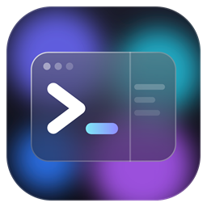

<p align="center"></p>

# termx

A small, fast glass terminal for Windows, in Rust (tao + wry) with xterm.js on top of ConPTY.
Same frosted acrylic backdrop as prism and anion.

## Features

- Real desktop blur behind the window, three glass levels (Solid / Frosted / Clear)
- Tabs of split panes, like Tilix or Terminator
- Profile dropdown listing the shells it finds: PowerShell 7, Windows PowerShell, Command Prompt, Git Bash and every WSL distro
- Built-in robbyrussell-style prompt (`➜  folder git:(branch)`) for PowerShell, cmd and Git Bash, plus zsh-style Tab menu completion in PowerShell. Steps aside if you use oh-my-posh or starship
- Wobbly window drag
- GPU (WebGL) rendering, ~1 MB binary, webview memory trimmed while idle
- Remembers window position, size, glass level, font size and toggles

## Keys

| Keys | Action |
| --- | --- |
| `Ctrl+Shift+T` | New tab |
| `Ctrl+Shift+1`…`9` | New tab with profile N |
| `Ctrl+Shift+Space` | Profile / split dropdown |
| `Ctrl+Shift+E` / `Ctrl+Shift+O` | Split right / down |
| `Alt+Shift+Arrow` | Split in that direction |
| `Alt+Arrow` | Move focus between panes |
| `Ctrl+Shift+W` | Close pane |
| `Ctrl+Tab` / `Ctrl+Shift+Tab` | Next / previous tab |
| `Ctrl+C` | Copy if text is selected, otherwise interrupt |
| `Ctrl+V`, `Ctrl+Shift+V`, right-click | Paste (right-click copies when there is a selection) |
| `Ctrl+=` / `Ctrl+-` / `Ctrl+0` | Font size |
| `Ctrl+click` | Open link |

Alt+click a profile in the dropdown to open it in a split. Drag pane dividers to resize.

## Custom shell

To add your own shell as the first profile, set `shell` and `args` in `%LOCALAPPDATA%\termx\state.json`:

```json
{ "shell": "C:\\tools\\nu.exe", "args": [] }
```

## Build

```
cargo build --release
```

The binary is `target\release\termx.exe`. xterm.js and its addons are vendored in `src/vendor` (MIT, see `LICENSE-xterm`).

## Icons

`assets/logo.svg` is the master (48px and up) and `assets/logo-small.svg` the simplified mark for 16–32px.
After editing either, regenerate `icons/icon.ico`, `icons/icon.png` and `icons/png/*` with:

```
powershell -ExecutionPolicy Bypass -File scripts\icons.ps1
```

## Release

CI runs fmt, clippy and a release build on every push. To publish a release, bump `version` in `Cargo.toml`, then:

```
git tag v0.1.0
git push origin v0.1.0
```

The release workflow checks the tag matches `Cargo.toml` and attaches `termx.exe`, a zip and `SHA256SUMS.txt`. Tags with a `-` (e.g. `v0.2.0-beta.1`) are marked as pre-releases.

## License

MIT
